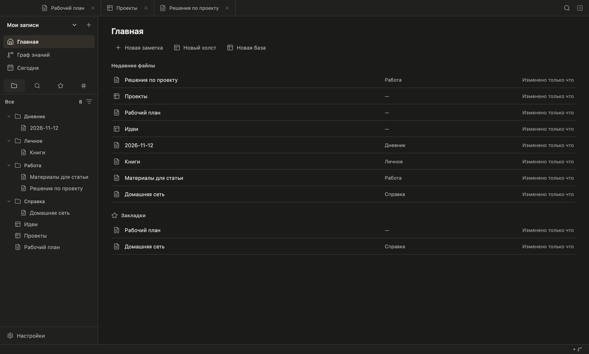
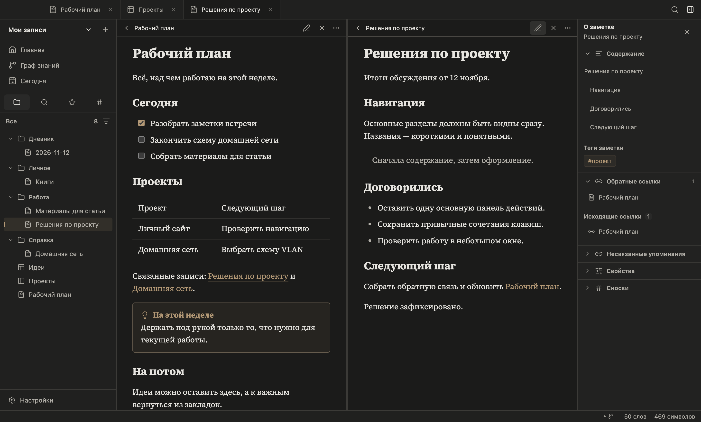
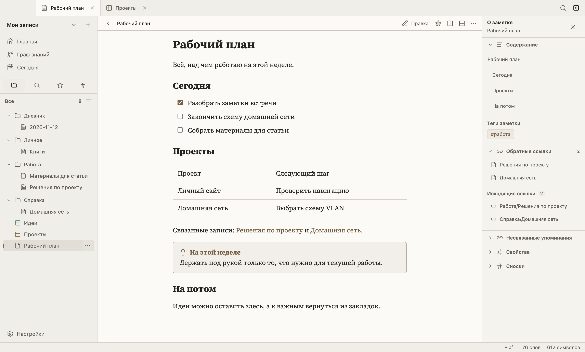
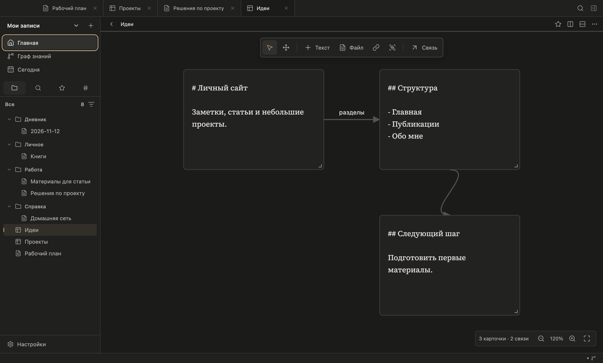
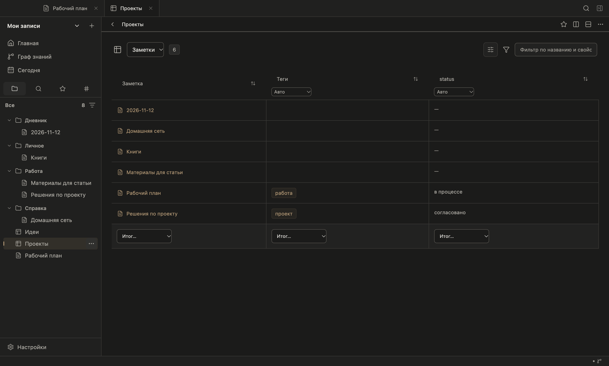

# Veltrite

**Локальная база знаний для macOS и Windows.** Заметки в Markdown, визуальные холсты и зашифрованный обмен через ваш приватный репозиторий GitHub.

Файлы остаются в выбранной папке. Для работы с заметками не нужны аккаунт или интернет. GitHub подключается отдельно, когда нужна синхронизация. Приёмка реального пользовательского обмена и браузерного входа запланирована отдельным этапом; текущие проверки транспорта используют синтетические клиенты.



## Интерфейс

Вкладки находятся в верхней строке окна. Слева — папки, поиск, закладки и теги; справа — сворачиваемые разделы заметки. Главная и коллекции показывают списки файлов. Документы можно разделять вправо и вниз, сохранять расположение и открывать один черновик в нескольких панелях. Для текста доступны три семейства шрифтов; оформление устанавливается из каталога, JSON или CSS; горячие клавиши настраиваются.

[Обзор интерфейса](docs/Интерфейс.md) · [Навигация и горячие клавиши](docs/Использование.md)





## Возможности

- Markdown: редактор с живым оформлением, исходный код, чтение и предпросмотр рядом; формулы, таблицы, списки задач, сноски и Mermaid.
- Папки, вкладки и панели; поиск с AND/OR/NOT, группами, свойствами и регулярными выражениями; теги, YAML, закладки, ежедневные заметки и шаблоны.
- Wiki-ссылки `[[Заметка]]`, псевдонимы, ссылки на заголовки и блоки, встраивание фрагментов и предпросмотр при наведении; содержание и граф знаний.
- Холсты `.canvas`: текст, файлы, изображения, изолированные веб-карточки, группы и связи; обзор больших холстов.
- Базы `.base`: таблицы, карточки, списки, канбан и карты, восемь типов свойств, редактор представлений, типизированные формулы, группировки, обложки и общие итоги.
- JavaScript-расширения со своим API, разрешениями и отдельными процессами; каталог расширений и тем.
- История изменений, корзина, экспорт папки, PDF, HTML и статического сайта.
- GitHub Sync: шифрование на устройстве, отдельный приватный репозиторий пользователя, объединение независимых правок и сохранение конфликтующих версий.
- PDF и мультимедиа во вкладках; вложенные заметки, холсты, базы и PDF внутри чтения, с защитой от циклов.
- Извлечение и объединение текста с переносом адресов, метаданных и закладок; общий менеджер свойств.
- Открытие локальной папки и импорт её копии со структурой, закладками, панелями, шаблонами, типами свойств и CSS.

Поддержанные форматы, API и ограничения описаны в [таблице возможностей](docs/Возможности.md). Документация: [поиск](docs/Поиск.md), [базы и карты](docs/Базы-и-карты.md), [расширения](docs/Расширения.md), [каталог и темы](docs/Каталог-и-темы.md).





## Установка

Сборки распространяются через [GitHub Releases](https://github.com/AncherbakNA/veltrite/releases):

- macOS Apple Silicon — файл `mac-arm64.dmg` или ZIP с приложением;
- macOS Intel — файл `mac-x64.dmg` или ZIP;
- Windows x64 — установщик `win-x64.exe` либо ZIP.

На Windows новая версия загружается и устанавливается из «Настройки → О приложении» после сохранения заметок. Mac без Developer ID обновляется заменой приложения из DMG. Сертификатов издателя пока нет: Mac использует ad-hoc подпись целостности, Windows собирается без подписи издателя. [Установка, обновления и подключение сертификатов](docs/Установка-и-обновления.md).

## Начало работы

1. Нажмите **Создать хранилище** или **Открыть папку**.
2. Создайте заметку через `⌘/Ctrl + N`.
3. Используйте `[[Название]]`, чтобы связать заметки.
4. Откройте палитру `⌘/Ctrl + P`, чтобы найти любой инструмент.
5. Для переноса выберите **Импорт из папки** в меню названия хранилища. Оригинал останется на месте.

[Импорт папки](docs/Импорт.md) · [Синхронизация](docs/Синхронизация.md) · [Горячие клавиши](docs/Использование.md)

## Запуск из исходников

Нужны **Node.js 24** и **pnpm 11.25**. Клонируйте репозиторий и выполните:

```sh
pnpm dev
```

**Не выполняйте `pnpm install` в папке исходников.** Команда запуска сама создаёт соседнюю папку `Veltrite-local/workspace`, копирует туда исходники, устанавливает зависимости и запускает приложение. В исходном проекте остаются только файлы для GitHub.

```sh
pnpm check       # Проверка типов
pnpm test        # Файлы, импорт, шифрование и обмен между двумя клиентами
pnpm test:e2e    # Проверки настоящего Electron-приложения
pnpm build      # Сборка интерфейса и основного процесса
pnpm dist:mac   # DMG и ZIP для Apple Silicon
pnpm dist:win   # Установщик и ZIP для Windows x64
node scripts/workspace.mjs dist:mac:x64  # Сборка для Intel Mac
```

Другую внешнюю папку можно задать переменной `VELTRITE_LOCAL_DIR`. Она должна находиться вне исходников. Зависимости, отчёты, тестовые данные и готовые установщики не попадают в репозиторий.

[Проверки выпуска](docs/Проверки.md) · [Архитектура и разработка](docs/Разработка.md) · [Подготовка релиза](docs/Релизы.md) · [Защита данных](SECURITY.md)

## Лицензия

MIT. Лицензии зависимостей, включая локальный шрифт Source Serif 4 (OFL-1.1), включаются в сборку в `THIRD_PARTY_NOTICES.txt`.
