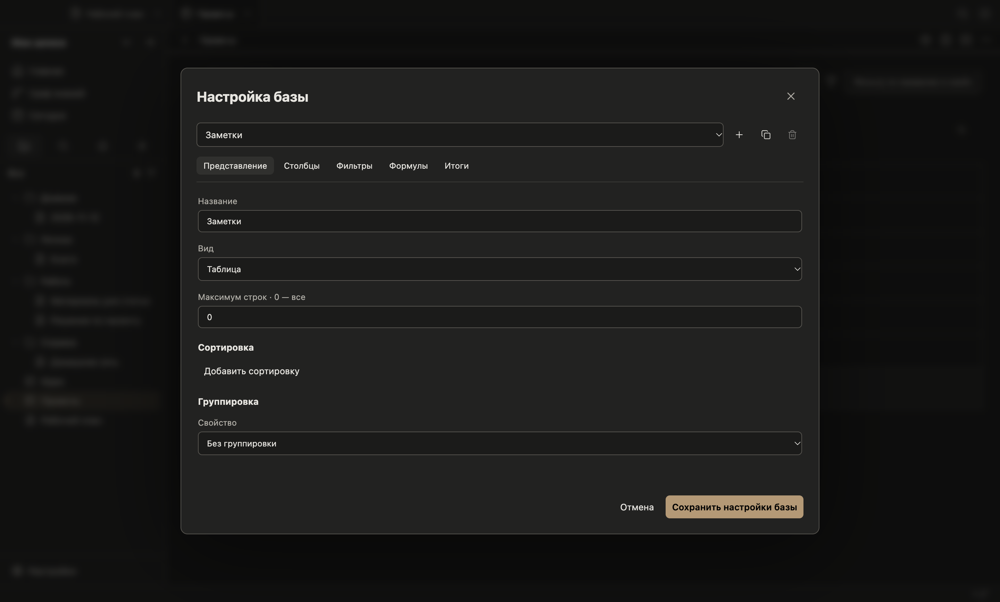

# Базы и карты

Файл `.base` содержит YAML с фильтрами, свойствами, формулами и представлениями. Неизвестные поля сохраняются при изменении сортировки, типов и итогов.

```yaml
filters: file.ext == "md"
properties:
  price:
    type: number
  done:
    type: checkbox
  deadline:
    type: date
formulas:
  double: price * 2
summaries:
  doubleTotal: values.sum() * 2
views:
  - type: table
    name: Задачи
    order: [file.name, price, done, deadline, formula.double]
    summaries:
      price: Sum
      formula.double: doubleTotal
  - type: map
    name: Места
    latitude: latitude
    longitude: longitude
```

Тип свойства можно выбрать под названием столбца. Двойной щелчок открывает ячейку для правки, флажок переключается одним нажатием. Поддержаны `text`, `number`, `checkbox`, `date`, `datetime`, `list`, `tags`, `url`. Изменение типа задаёт правила для последующих правок и не переписывает значения остальных заметок. Пустая ячейка хранит `null`, пустой список или выключенный флажок в зависимости от типа.

Внизу таблицы доступны количество, заполненные и пустые значения, уникальные значения, сумма, среднее, медиана, минимум, максимум, размах, ранняя и поздняя даты, количество и доля отмеченных флажков. Итоги считаются по отфильтрованным строкам, включая ограничение `limit`. Именованный итог задаётся выражением в `summaries`; список значений доступен как `values`.

Формулы вычисляются ограниченным интерпретатором. Кроме арифметики, сравнений, `if`, дат, строк и функций списков доступны `filter`, `map`, `some`, `every` с локальными переменными `value` и `index`. Например: `[1,2,3].filter(value > 1).map(value * 2).sum()`. `duration("2d")` возвращает длительность, которую можно прибавить к дате. Произвольный JavaScript и доступ к прототипам не поддерживаются. Ошибка выражения показывается в ячейке.

Представление `map` использует широту и долготу из свойств, по умолчанию `latitude` и `longitude`. Допустимы широты от −90 до 90 и долготы от −180 до 180, включая нулевые координаты. Без сети видны точки и координатная сетка. Кнопка «Загрузить карту OpenStreetMap» включает подложку; запросы содержат координаты тайлов, а содержимое заметок не отправляется. Приложение использует HTTP-кэш Chromium и собственный User-Agent. Массовая загрузка карт не предусмотрена. Подложка предоставляется [OpenStreetMap](https://www.openstreetmap.org/copyright) по [правилам сервиса тайлов](https://operations.osmfoundation.org/policies/tiles/).

## Настройка без редактирования YAML



Кнопка **Настроить базу** открывает представления, столбцы, фильтры, формулы и итоги. Можно добавить или скопировать представление, выбрать вид, лимит, несколько сортировок, свойство группировки и порядок видимых групп. У карточек выбираются обложка и ширина, у карты — свойства широты и долготы. Столбцы можно скрывать, перемещать, переименовывать и менять их ширину.

Фильтры объединяются в группы «Все условия», «Хотя бы одно» и «Ни одно». Доступны конструктор условия и прямое выражение. При переименовании формулы изменяются обращения к ней в других формулах, фильтрах и представлениях; текстовые строки и regex остаются буквальными. Формулу, от которой зависят другие выражения, сначала нужно убрать из этих выражений. Настройка изменяет отдельные узлы YAML, сохраняя комментарии и неизвестные поля.

## Значения и функции

`file.name` содержит расширение, `file.basename` — имя без него. Доступны `path`, `folder`, `ext`, `size`, `ctime`, `mtime`, `tags`, `properties`, `links`, `backlinks` и `embeds`. `file.hasTag()`, `hasProperty()`, `hasLink()`, `inFolder()` и `asLink()` работают с метаданными файлов. `this` относится к самой базе, а при встраивании — к содержащей её заметке.

Кроме обычных чисел, строк и списков используются даты, длительности, ссылки, файлы, изображения, иконки и безопасное HTML-представление. Ссылка свойства `[[Файл]]` поддерживает `asFile()`; её подпись можно заменить `link()` или `file.asLink()`. В `html()` скрипты, формы, события и опасные адреса удаляются; удалённое изображение запрашивается только после нажатия.

```text
file.asLink(icon("file-text"))
link("Проекты/План.md", "Открыть план")
image(cover)
if(done, icon("check"), icon("clock"))
[1,2,3].reduce(acc + value * 2, 0)
"a:b:c".replace(":", "-")
/проект/i.matches(file.name)
(file.mtime + "7d").format("DD.MM.YYYY")
(date("2024-01-31") + "1M").format("YYYY-MM-DD")
```

У строк доступны поиск, регистр, замена, разбиение, срез, повторение и разворот; у списков — обход, фильтрация, свёртка, сортировка, уникальные значения и агрегаты; у объектов — ключи и значения. Для `map`/`filter`/`reduce` доступны `value`, `index` и `acc`. Календарная арифметика учитывает длину месяцев. Регулярные выражения задаются как `/шаблон/флаги`.

Вычисления работают в отдельном worker с пределом восемь секунд, ограничениями глубины, числа шагов, длины результатов и общего кэша 32 МиБ. Они не блокируют редактор. Страницы содержат до 200 строк; фильтрация, сортировка, группировка и итоги выполняются по всем строкам результата. Ошибки формул показываются в ячейках и предупреждении.

## Встраивание

`![[Проекты.base#Мои карточки]]` показывает именованное представление. YAML также можно поместить в блок кода с языком `base`. Встроенная база позволяет менять свойства заметок и временно выбирать вид/сортировку; её определение настраивается при открытии файла базы. Условие `note.project == this.project` отбирает строки относительно содержащей заметки.
