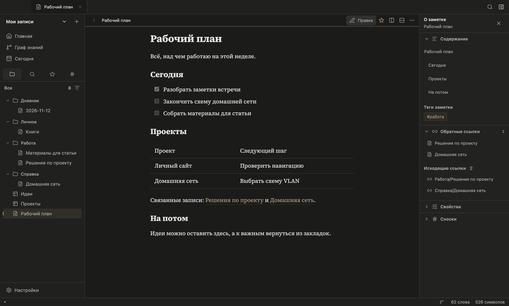

# Интерфейс Veltrite 0.2

## Главное окно

Верхняя строка содержит открытые вкладки, лупу для перехода к файлу и переключатель правой панели. На macOS слева оставлено место для кнопок окна.

Слева находятся название хранилища с меню, «+» для создания файла, главная, граф и ежедневная заметка. Под ними — компактный ряд инструментов: файлы, поиск, закладки и теги. Фильтр в заголовке дерева открывает коллекции текста, холстов и баз.

Главная показывает недавние файлы: имя, папку и время изменения. Закладки появляются отдельным списком. В **Настройки → Оформление** можно выбрать, что открывать при запуске: последнюю заметку или главную. Открытые вкладки сохраняются в обоих случаях.

## Заметка

Путь и действия с документом занимают одну строку. Кнопка «Чтение» переходит к чтению, «Правка» возвращает редактор; сочетание **⌘/Ctrl + E** работает в обе стороны. Исходный код и режим «Рядом» находятся в меню **⋯**.

Справа находятся сворачиваемые разделы: содержание, обратные и исходящие ссылки, свойства и сноски. В компактном окне панель открывается по кнопке справа в строке вкладок.

Тихая точка внизу показывает сохранение. Текст появляется при несохранённых изменениях или ошибке; кнопка обмена показывает синхронизацию и её ошибки.

## Коллекции

Коллекция — таблица с именами, папками и датами. Поиск учитывает имена, пути, заголовки заметок и теги. Создание нового файла доступно справа от заголовка коллекции.

## Холст и база

У карточек холста цвет обозначен тонкой рамкой. Заголовок файловой карточки показывает имя без пути и расширения. Инструменты добавления и соединения расположены над холстом; подсказка видна только на пустом холсте.

База открывает представления файлов: таблицу, карточки, список или канбан.

## Оформление

Тёмная тема использует графитовые поверхности, светлая — бумажные. Доступны шесть готовых акцентов и собственный HEX-цвет. Для заметок можно выбрать шрифт с засечками, без засечек или моноширинный. Source Serif 4 включён в приложение и работает без интернета.

## Компактное окно и первый запуск

Первый экран содержит три действия: создать хранилище, открыть папку или импортировать её копию. Ниже отображаются недавно открытые хранилища.

Основной акцент — приглушённая медь. На тёмной теме он светлее, на светлой — глубже. Акцент используется для ссылок, фокуса и выбранных инструментов; большие поверхности остаются нейтральными. В настройках есть медь, олива, глина, табак, слива, графит и собственный цвет. Старый основной оттенок заменяется при открытии хранилища; другие пользовательские цвета сохраняются.
