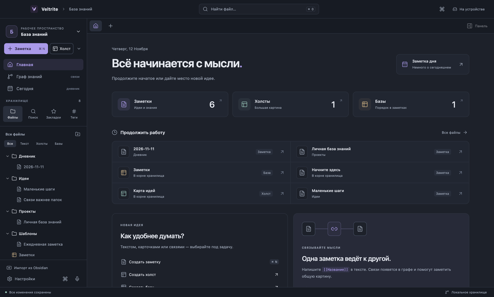
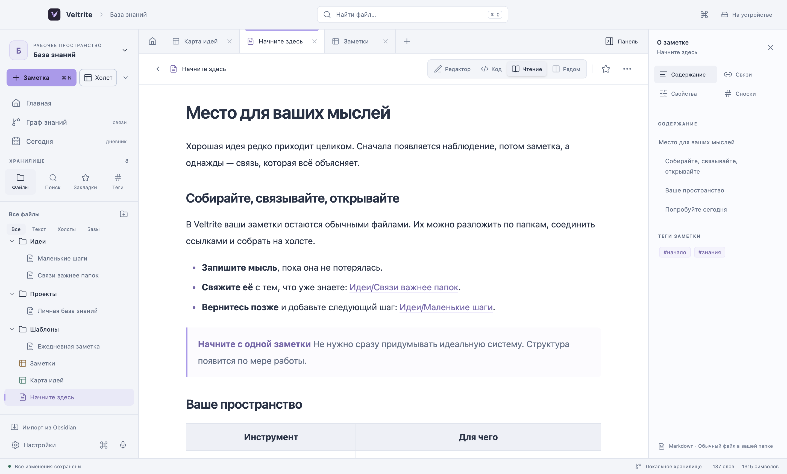
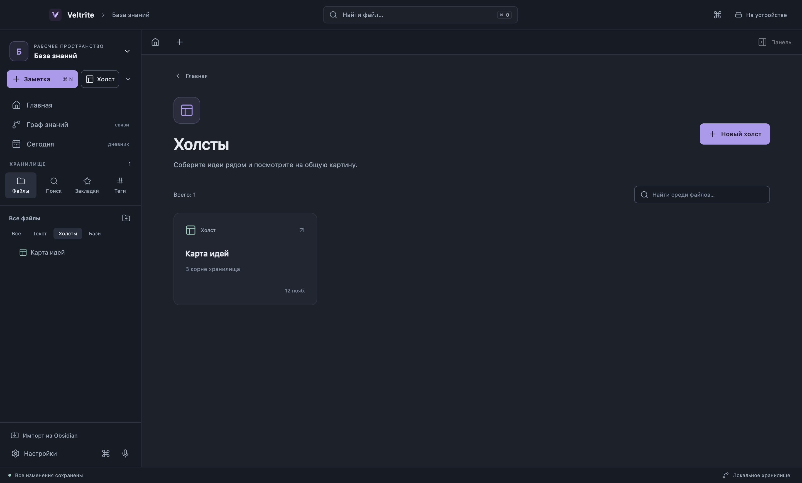
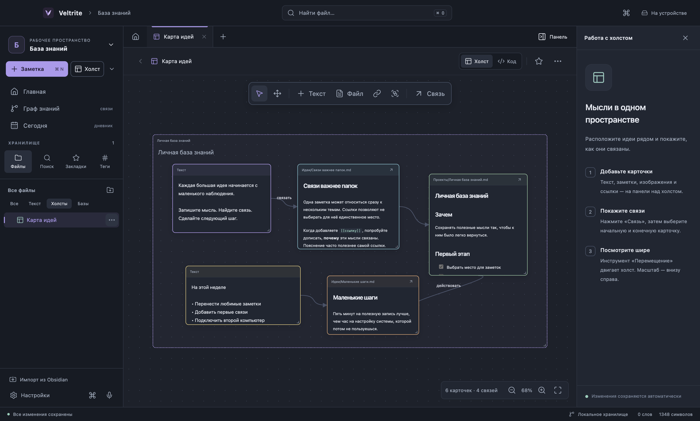
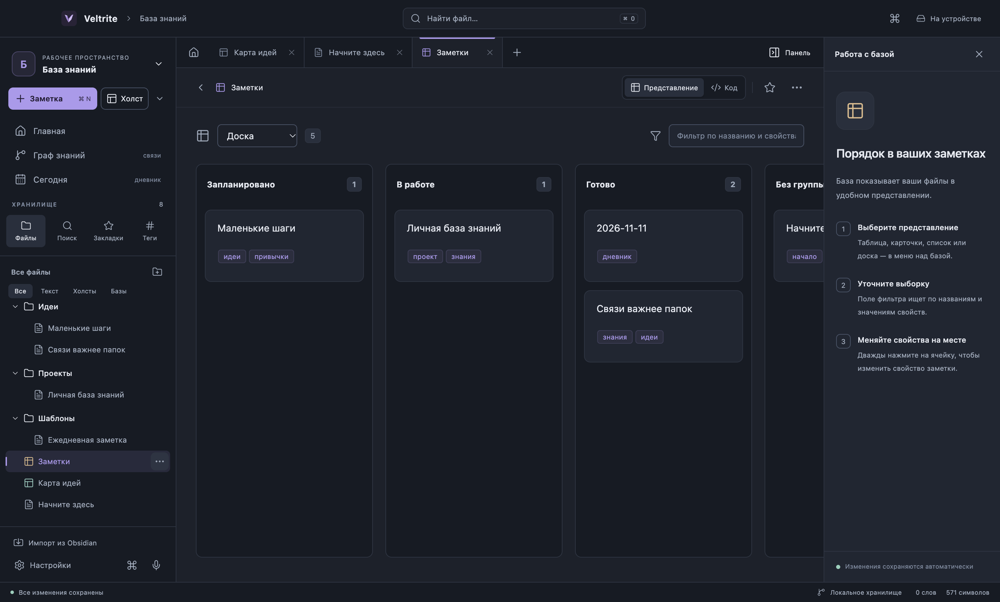
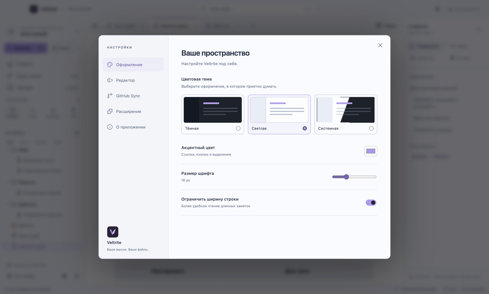
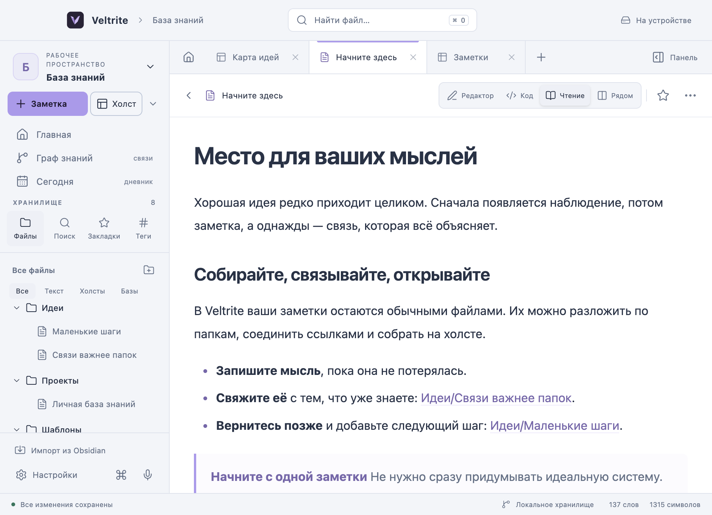
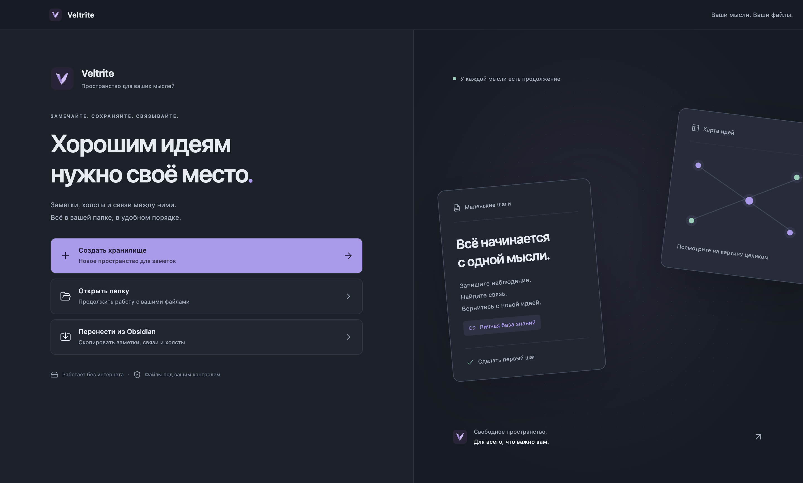

# Пространство Veltrite 0.2

## Главная

Вернитесь к недавним файлам, откройте заметку дня или создайте новую идею. Карточки «Заметки», «Холсты» и «Базы» ведут в отдельные коллекции. Переход на главную не закрывает вкладки и не теряет правки.

## Подписанная навигация

| Где                          | Что находится                                                  |
| ---------------------------- | -------------------------------------------------------------- |
| Вверху слева                 | Название и переключение хранилища                              |
| Кнопки «Заметка» и «Холст»   | Создание файлов; стрелка рядом — база и папка                  |
| Главная, граф и сегодня      | Основные разделы пространства                                  |
| Файлы, поиск, закладки, теги | Инструменты работы с хранилищем                                |
| Строка над документом        | Его место в папках и режим просмотра                           |
| Кнопка «Панель»              | Содержание, связи, свойства, сноски либо подсказки инструмента |
| Внизу слева                  | Настройки, все команды и аудиозапись                           |
| Строка состояния             | Сохранение файлов и подключение синхронизации                  |

## Коллекции

Файлы одного типа собраны в карточки. Видны папка, тип, теги заметки и дата изменения. Поиск по коллекции учитывает названия, пути и теги. Фильтры проводника слева помогают оставить нужный тип файлов.

## Холсты и базы

Важные действия холста подписаны: «Текст», «Файл», «Связь». Справа есть короткие подсказки. Для холста и базы доступны визуальный режим и исходный код — без переключателей, которые не меняют представление.

## Темы и небольшое окно

Настройки показывают образцы тёмной, светлой и системной темы. Системная тема реагирует на изменения оформления ОС без перезапуска. В небольшом окне панель справа закрывается автоматически; кнопка «Панель» открывает её поверх документа.

## Первый запуск

Есть три понятных пути: создать новое хранилище, открыть существующую папку или скопировать хранилище Obsidian. Аккаунт для локальной работы не нужен.

